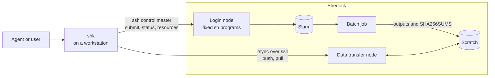

<div align="center">

# sherlock-kit

**Slurm jobs, verified transfers and capacity snapshots on Stanford's
[Sherlock](https://www.sherlock.stanford.edu) and
[Marlowe](https://marlowe-research.stanford.edu) clusters, built for coding agents.**

[](https://github.com/FridrichMethod/sherlock-kit/actions/workflows/ci.yml)
[](https://github.com/FridrichMethod/sherlock-kit/releases/latest)
[](pyproject.toml)
[](pyproject.toml)
[](LICENSE)

[Quick start](#quick-start) | [Commands](#commands) | [Marlowe](#marlowe) | [Documentation](docs/README.md) | [Changelog](CHANGELOG.md)

</div>

`shk` is a small, stateless command-line interface that submits and tracks
Slurm jobs, moves data and reads partition capacity on Sherlock, from a
workstation over OpenSSH or on Sherlock itself. Every operational command
prints one JSON document and a meaningful exit code, so an agent can act on the
result without parsing prose. Sherlock is the default site; `--site marlowe`
drives Stanford's Marlowe cluster the same way ([Marlowe](#marlowe)).

## Highlights

- **Slurm is the source of truth.** A job's name is derived from its logical
  task, so `submit` asks Slurm whether that task is new, live, done or failed.
  `shk` keeps no local state, cache or ledger.
- **Safe to retry.** A live task is never submitted twice, a finished one only
  with `--resubmit REASON`, and a mutation whose result cannot be proven is
  reported as outcome unknown (exit 5) together with the `shk status` command
  that settles it.
- **Never logs in.** `shk` rides the OpenSSH control masters you open yourself
  and never handles credentials.
- **Verified transfers.** `pull` fetches only the files that the job's
  `SHA256SUMS` lists, verifies every one, runs your validator and only then
  puts the copy in place.
- **Honest capacity.** `resources --summary` counts free CPUs, memory, GPUs and
  job-shaped slots per partition, GPU model and node class; what Slurm does not
  show stays null, never 0.
- **Agent-ready.** Operating rules and a skill for Claude Code and Codex ship
  with the package for each site, so each project gets the rules of the
  version it pins.
- **Small and dependency-free.** One standard-library Python package plus fixed
  POSIX `sh` programs that run on the login node.

## How it works



- Each command runs fixed programs over the control master you opened, parses
  their replies strictly and prints the result as one JSON document.
- Data moves through the data transfer node with `rsync`; a pull is verified
  against the manifest the job wrote before it appears locally.
- On Sherlock, on a login node or inside a job, the same programs run locally,
  so a controller job can submit and poll its own later stages. On Marlowe
  they run locally there too, but a job's `shk` calls are steps of its own
  work and no job waits or polls
  ([controllers inside a job](docs/cli.md#controllers-inside-a-job)).

## Install

Pin a release tag as a dependency of the project that uses `shk` (Python 3.11
or newer; `main` can be ahead of the latest release):

```toml
[project]
dependencies = [
    "sherlock-kit @ git+https://github.com/FridrichMethod/sherlock-kit@v0.11.0",
]
```

or install it into the project environment directly:

```sh
pip install 'sherlock-kit @ git+https://github.com/FridrichMethod/sherlock-kit@v0.11.0'
```

`shk --version` then prints `sherlock-kit 0.11.0 (git <commit>)`. The pin
decides which `shk` runs; `[tool.sherlock-kit]` (step 2 below) describes the
project. `shk` releases often: name the version in that one tag and the lock
file, not in the project's code, tests, job scripts or guides, so that an
upgrade changes nothing else. A separate environment for `shk`, upgrades, environments on Sherlock,
use inside jobs, submodules and editable installs are covered in
[Installation and connection](docs/install.md).

## Quick start

**1. Open the SSH masters.** `shk` reuses one OpenSSH control master on a login
node and one on a data transfer node (DTN). Define both in `~/.ssh/config`, then
open them yourself:

<details>
<summary>Minimal <code>~/.ssh/config</code> (replace <code>SUNETID</code>)</summary>

```sshconfig
Host sherlock-plain
  HostName login.sherlock.stanford.edu
  User SUNETID
  ControlMaster auto
  ControlPersist yes
  ControlPath ~/.ssh/%C

Host sherlock-dtn
  HostName dtn.sherlock.stanford.edu
  User SUNETID
  ControlMaster auto
  ControlPersist yes
  ControlPath ~/.ssh/%C
```

</details>

```sh
ssh sherlock-plain          # authenticate once; the master persists
ssh -fN sherlock-dtn
```

**2. Describe the project** in `pyproject.toml` (or the top level of
`sherlock-kit.toml`):

```toml
[tool.sherlock-kit]
project = "demo"
remote_root = "/scratch/users/USER/demo"

[tool.sherlock-kit.validators]
bundle = ["python", "-m", "demo.validate_bundle"]
```

**3. Write a job that ends with a manifest.** Its last step writes
`out/SHA256SUMS` over the output directory, never over the run directory
itself:

```bash
#!/bin/bash -l
set -e
mkdir -p out
echo "hello from job $SLURM_JOB_ID" > out/hello.txt
"$GROUP_HOME/demo/.venv-shk/bin/shk" manifest out
```

The job calls the project's pinned install on Sherlock by its absolute path
([how to create it](docs/install.md#environments-on-sherlock)), or the
`sha256sum` one-liner from the skill.

**4. Submit, poll and pull:**

```sh
shk doctor                  # offline: Python, ssh, rsync, config, both ssh masters
shk submit --task smoke --script job.sh --partition normal --cpus 1 --mem 2G --time 20m --dry-run
shk submit --task smoke --script job.sh --partition normal --cpus 1 --mem 2G --time 20m
shk status --task smoke     # at least 60 s apart; the reply says when (next_check_after)
shk wait --task smoke --timeout 2h  # one reply when the task settles, fails or the timeout comes
mkdir -p results            # pull creates LOCAL, never its parent
shk pull /scratch/users/USER/demo/runs/shk.demo.smoke.4a30f57203/out results/smoke --validate bundle
```

The dry run is offline and shows exactly what would be submitted (abridged; the
reply also holds the script hash and the frozen spec):

```json
{
  "schema_version": 1,
  "ok": true,
  "action": "dry_run",
  "name": "shk.demo.smoke.4a30f57203",
  "run_dir": "/scratch/users/USER/demo/runs/shk.demo.smoke.4a30f57203",
  "argv": ["sbatch", "--parsable", "--job-name=shk.demo.smoke.4a30f57203", "--partition=normal", "..."]
}
```

The name is the same on every machine and for every retry of the task: it is
how `shk` finds the task in Slurm.

## Commands

| | Command | What it does |
|---|---|---|
| Jobs | `shk submit` | Submit one logical task: offline `--dry-run`, Slurm's verdict with `--preflight` |
| | `shk status` | State, anomalies and cost of tasks from one `squeue` and one `sacct` call |
| | `shk wait` | Repeat the status read, at least 60 s apart and bounded by `--timeout`, until the tasks settle or one fails; one reply at the end |
| | `shk cancel` | Cancel the live jobs of one task or name |
| | `shk release` | Release an identity-verified user hold |
| | `shk update` | Change one field of an identity-verified job in place: a shorter time limit, the partition or the features while it pends, or an array's throttle |
| Capacity | `shk occupancy` | Running and pending jobs per user; required before borrowed partitions |
| | `shk resources` | Configured minus allocated node capacity, per node or as a `--summary` |
| Accounting | `shk usage` | Marlowe usage and estimated cost per month and rate period |
| Data | `shk push` | rsync a local directory to Sherlock through the DTN; never deletes |
| | `shk pull` | Fetch the files `SHA256SUMS` lists, verify and validate them, then create LOCAL |
| | `shk manifest` | Write `DIR/SHA256SUMS` inside a job |
| Inside a job | `shk allocation` | Prove that a local worker process belongs to this job, array element or step |
| | `shk requeue --self` | Requeue the current job on a partition that allows it |
| Setup | `shk doctor` | Read-only checks of the tools, the configuration and both SSH masters |
| | `shk rules` | Print the packaged operating rules for agents |
| | `shk install-skill` | Copy the agent skill, and optionally the rules, into a project |

`shk <command> --help` is the authoritative flag list. The
[command reference](docs/cli.md) documents every reply, the configuration keys
and the exit codes:

| Exit | Meaning |
|---|---|
| 0 | ok |
| 1 | local error: configuration, spec, verification, validator, malformed reply, failed remote read |
| 2 | usage error |
| 3 | refused, and nothing was submitted, cancelled, released, requeued or updated |
| 4 | SSH transport or master check unavailable |
| 5 | outcome unknown after a dispatched mutation: run the `shk status` command in the reply's `next` |
| 6 | status ok, but the newest job of a requested name has an anomaly |

## For agents

The rules for agents on a workstation or on Sherlock and the `sherlock-kit`
skill are package data, delivered by the installed version:

```sh
shk rules workstation                              # or: shk rules cluster
shk install-skill --project . --rules workstation  # skill for Claude Code and Codex, plus rules
```

After a submit, an agent ends its turn, or runs one bounded `shk wait` in the
background, whose exit its harness reports, instead of checking the job by
hand; a wait never outlives the session that started it.

`shk` does not authorize resources, infer borrowed access, police what a job
script does or certify scientific results. Sherlock's own `/etc/agents/AGENTS.md`
takes precedence over the packaged rules.

## Marlowe

Marlowe is the second packaged site. Every Marlowe command is
`shk --site marlowe ...`, over the user's `marlowe-plain` master (one alias
for commands and rsync) or locally on a Marlowe login node or inside a
Marlowe job. A project on both clusters adds a Marlowe configuration in its
own directory:

```toml
# <repo>/marlowe/sherlock-kit.toml
site = "marlowe"
project = "demo-mw"                        # distinct from the Sherlock value
remote_root = "/scratch/m000000/USER/demo"
account = "marlowe-m000000"                # the base project account, required
```

```sh
shk --site marlowe --project-dir marlowe doctor
shk --site marlowe --project-dir marlowe submit --task smoke --script job.sh --partition preempt --cpus 1 --mem 2G --time 20m --dry-run
shk --site marlowe rules workstation
shk --site marlowe install-skill --project . --rules workstation
```

On Marlowe `shk` passes the account to `sbatch`, lists only the partition
`preempt`, and tests every submit with `sbatch --test-only` before staging it,
so a request that Slurm refuses is exit 3 with nothing staged. Replies carry
`"site": "marlowe"`. Every job there is charged per CPU-hour and GPU-hour;
`shk --site marlowe usage --start YYYY-MM-DD` estimates the project
account's usage and its cost per month and rate period from Slurm accounting
and a packaged, dated rate table, an estimate and not the bill.
Marlowe support needs a release whose `shk --help` lists `--site`;
[Installation and connection](docs/install.md#marlowe) covers the setup and
[Marlowe policy](docs/marlowe-policy.md) the provenance of its rules.

## Documentation

| Guide | Purpose |
|---|---|
| [Installation and connection](docs/install.md) | Install forms, environments on Sherlock and inside jobs, SSH control masters, Marlowe setup |
| [Command reference](docs/cli.md) | Every command and its JSON reply, configuration and exit codes |
| [GPU campaign scheduling](docs/campaign-throughput.md) | Compatible GPUs, soft preferences, partitions, resumable bundles and parallel work |
| [Allocation proofs](docs/allocation.md) | Job, array element, process and step identity inside an allocation |
| [CPU thread budgets](docs/cpu-threads.md) | Numerical library thread defaults on the host and in containers |
| [Sherlock policy](docs/sherlock-policy.md) | Site-rule provenance, owner preferences and toolkit policy choices |
| [Marlowe policy](docs/marlowe-policy.md) | Provenance of the Marlowe rules: documentation pages, owner choices and toolkit choices |
| [Observed Marlowe behavior](docs/validation/observed-marlowe.md) | Slurm 25.05.2 on Marlowe and `shk`'s own commands there, as seen live |
| [Design](docs/design.md) | Runtime components, sites, contracts, state resolution and accepted limitations |

The [documentation index](docs/README.md) also lists the observed Slurm
behavior that the parsers rest on.

## Development

```sh
python3 -m venv .venv && .venv/bin/python -m pip install -e '.[dev]'
.venv/bin/pre-commit run --all-files     # ruff, mypy, shellcheck, shfmt, mdformat
.venv/bin/python -B tests/run_suite.py   # offline: fake ssh and Slurm, real rsync and sh
```

[CONTRIBUTING.md](CONTRIBUTING.md) describes the packaging checks, the test
wheelhouse and the boundaries every change keeps.

## License

[MIT](LICENSE)
